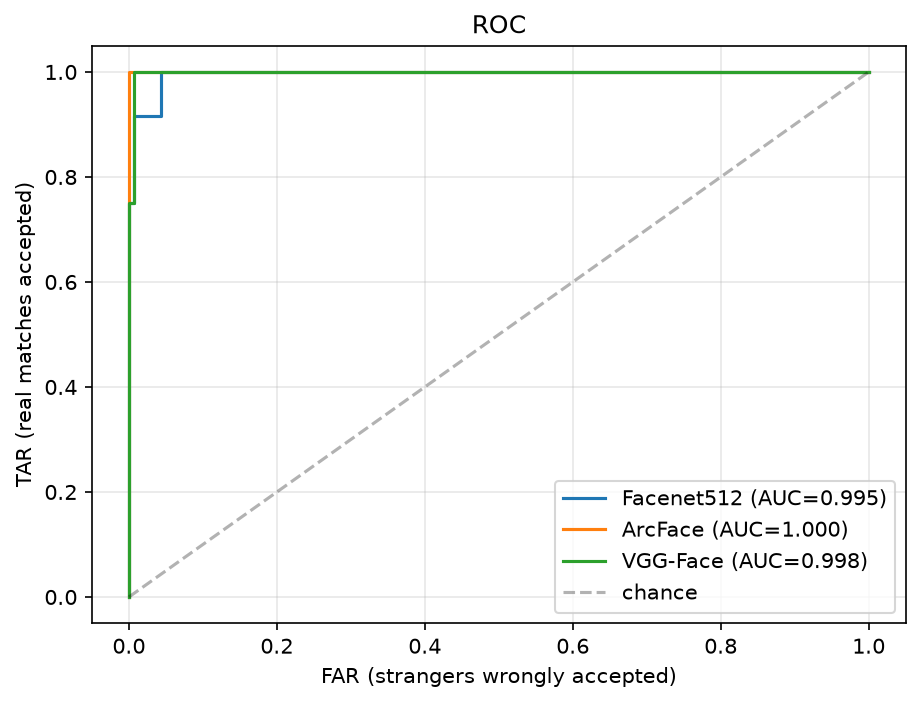

# Face Recognition Pipeline

Identify people in a photo (or say "Unknown") using face embeddings, cosine similarity and a tuned threshold. Demo in Streamlit, benchmark in a notebook.

## 1. The idea in 5 lines
1. **Detect** each face in the image and crop it.
2. **Embed**: a neural network (Facenet512) turns the crop into a vector of 512 numbers. Same person = vectors close together.
3. **Compare** with the gallery using **cosine similarity** (1.0 = same direction).
4. **Decide**: best match score >= threshold -> that person's name, otherwise **"Unknown"** (open-set recognition).
5. The model never "knows names". It only measures closeness; the gallery provides the names.

## 2. Architecture
```
data/gallery/<person>/*.jpg --build_gallery--> gallery.npz (embeddings + names)
photo --detect--> face crop --embed--> vector --cosine vs gallery--> best score
                                                                      |-- >= threshold -> name
                                                                      '-- <  threshold -> Unknown
```
| Path | Role |
|---|---|
| `src/recognizer.py` | core pipeline: `build_gallery`, `identify`, `draw` |
| `app.py` | Streamlit demo (upload a photo, adjust the threshold) |
| `notebooks/face_evaluation.ipynb` | benchmark of several models |
| `results/` | `roc_curve.png`, `metrics_table.csv`, `threshold.json` |

## 3. Run it
```bash
python -m venv .venv && source .venv/bin/activate      # Windows: .venv\Scripts\activate
pip install -r requirements.txt
# put photos in data/gallery/<person>/ and data/strangers/
python -c "from src.recognizer import build_gallery; build_gallery('data/gallery')"
streamlit run app.py
```

## 4. Evaluation (fill with your numbers from `results/metrics_table.csv`)
| Model | AUC | EER | TAR@FAR=1% | Strangers rejected | ms/image |
|---|---|---|---|---|---|
| Facenet512 | | | | | |
| ArcFace | | | | | |
| VGG-Face | | | | | |



Key terms:
- **FAR**: strangers wrongly accepted. **FRR**: real people rejected. **TAR = 1 - FRR**.
- Raising the threshold lowers FAR but raises FRR. The ROC curve shows this trade-off for every threshold, and **EER** is the point where FAR = FRR.
- The threshold is chosen from data (target FAR), not guessed.

## 5. Limitations
- Very small dataset (5-8 people): metrics are indicative, not statistically strong.
- The threshold was tuned on the same photos it is measured on (slightly optimistic).
- Sensitive to lighting, pose, occlusion (mask, glasses), image quality.
- Accuracy can differ across demographic groups; not validated here.
- No liveness detection: a printed photo of a person can fool it.
- Not suitable for security or legal decisions.

## 6. Privacy
- Photos and `gallery.npz` are biometric data. They are excluded by `.gitignore` and never pushed.
- Use only photos of people who gave consent.
- Embeddings can identify a person, so treat them like the photos.
- If deployed publicly, use a consented or synthetic demo gallery.